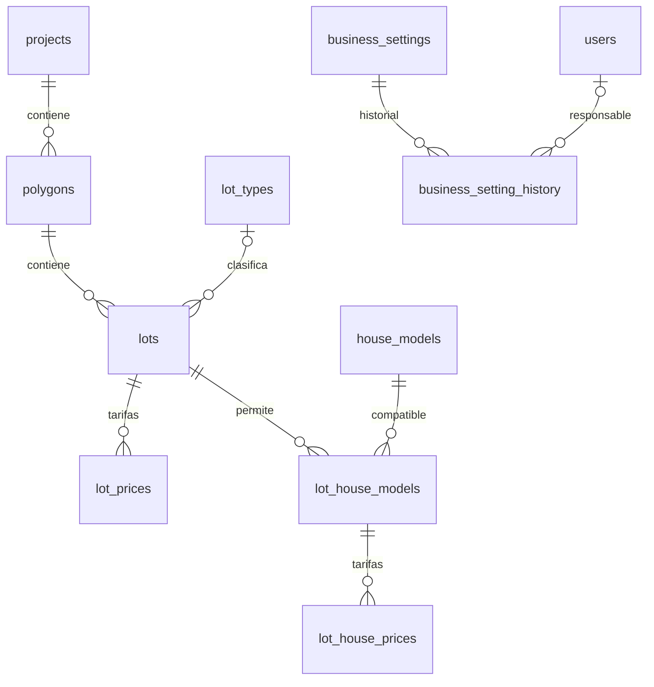

# Modelo de datos por etapas

## Implementado en esta entrega

Clave única comercial: proyecto + código de polígono + número de lote. Los números de lote son texto. La política del polígono (`blocked`, `partial`, `enabled`) es independiente del estado comercial del lote (`available`, `negotiating`, `reserved`, `sold`). `is_enabled` define la habilitación explícita para polígonos parciales. Un polígono habilitado no debe habilitar modelos incompatibles. Los futuros servicios comprobarán política, actividad del proyecto y estado antes de ofrecer o contratar.

Los lotes sin dimensiones verificadas pueden registrarse, pero no se autorizará una compatibilidad deduciéndola solo del área. La compatibilidad es explícita. Tarifas con `valid_from` inclusivo y `valid_until` exclusivo, o nulo sin término. El precio de paquete guarda terreno y construcción por separado y calcula su suma con DECIMAL. Los descuentos negociados pertenecerán al contrato, sin cambiar la tarifa histórica.

No se almacena «pagado» como estado comercial. La situación financiera se calculará desde contratos, cuotas y pagos validados cuando existan. La futura lectura de tarifa rechazará ambigüedades entre períodos; la edición de tarifa deberá bloquear la fila del lote/compatibilidad para impedir solapamientos concurrentes.

Fechas de negocio y configuración usan America/El_Salvador; las sesiones MySQL y trabajadores futuros deben usar la misma convención para DATETIME. Configuración inicial: negociación 15 días y gracia 10 días. `updated_by` y `changed_by` nulos únicamente para carga inicial/sistema; las ediciones humanas deberán exigir actor y motivo mediante servicio transaccional. No existe aún pantalla para modificar estos parámetros.

## Etapas posteriores, aún sin tablas ni servicios

1. Usuarios y permisos operativos: perfiles de CEO, ventas, asistentes y finanzas; filtros y alcance de datos por acción.
2. Clientes y oportunidades: varios interesados por lote, asignación temporal e historial. Cantidad de asignaciones principales simultáneas pendiente de confirmar.
3. Operaciones: terreno, terreno con casa y construcción posterior vinculada; precio pactado, cotización versionada y bloqueo concurrente de reservas/ventas.
4. Cuotas: calendario mensual por acuerdo, primera fecha explícita, día fijo, gracia y pagos parciales. Tratamiento de meses cortos y vigencia de modificaciones pendientes de confirmar.
5. Depósitos: cabecera única, aplicaciones a acuerdos/propiedades/conceptos y cuotas; respaldo privado. Registrador distinto de validador. Solo validación inicial aplica pago y permite emitir recibo inmutable.
6. Conciliación: cuentas, estados bancarios, líneas, correspondencias, incidencias y cierre. Permiso de Finanzas/Contabilidad. Conciliar no duplica el ingreso.
7. Panel ejecutivo: inventario y cobranza conectados, semáforo comercial e indicadores adicionales de mora y conciliación.

Las entidades futuras se agregarán con migraciones nuevas. No se crean ahora tablas incompletas de dinero o contratos para aparentar funcionalidad terminada. Precios por tipología se incorporarán con reglas de prioridad explícitas; las tarifas de esta entrega pertenecen a cada lote/combinación.
